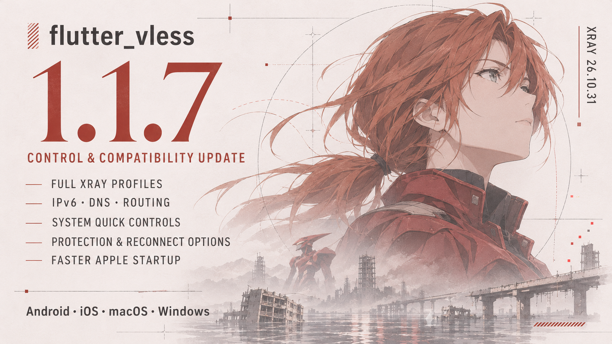

# flutter_vless — Xray/V2Ray VPN plugin for Flutter
[](https://pub.dev/publishers/tfox.dev/packages)
[](https://pub.dev/packages/flutter_vless)

Build cross-platform VPN and proxy apps for Android, iOS, macOS and Windows with VLESS Reality/XHTTP, VMess, Trojan, Shadowsocks, SOCKS5 and Hysteria2. Import share links, subscriptions, raw Xray JSON, Clash YAML, sing-box JSON and WireGuard profiles.

`flutter_vless` provides a compact Dart API for parsing share links and subscriptions, importing raw Xray JSON, Clash YAML, and sing-box JSON, generating Xray configurations, and running proxy-only or VPN/tunnel modes through native platform backends. WireGuard profiles are supported through Clash YAML and sing-box JSON imports.

The package is open source and free to use. Platform-specific setup may be required for VPN/tunnel mode. See the [documentation](https://github.com/XIIIFOX/flutter_vless/blob/main/doc/README.md), [platform guides](https://github.com/XIIIFOX/flutter_vless/blob/main/doc/platform/README.md), and [compatibility matrix](https://github.com/XIIIFOX/flutter_vless/blob/main/doc/compatibility.md).


## Official Package

`flutter_vless` is developed and maintained by 13FOX Studio / tfox.dev.

- Official package: [pub.dev/packages/flutter_vless](https://pub.dev/packages/flutter_vless)
- Official publisher: [pub.dev/publishers/tfox.dev](https://pub.dev/publishers/tfox.dev)
- Official repository: [github.com/XIIIFOX/flutter_vless](https://github.com/XIIIFOX/flutter_vless)
- Website: [tfox.dev](https://tfox.dev)
- Listed in the official Xray-core README under Xray Wrapper: [XTLS/Xray-core](https://github.com/XTLS/Xray-core#others-that-support-vless-xtls-reality-xudp-plux)

Redistributions and derived packages must preserve the copyright and MIT
license notices required by the license. See [NOTICE](https://github.com/XIIIFOX/flutter_vless/blob/main/NOTICE) and
[TRADEMARKS.md](https://github.com/XIIIFOX/flutter_vless/blob/main/TRADEMARKS.md).

## Contact & Services

Have a question for 13FOX Studio, need help integrating `flutter_vless`, or want
to discuss a custom Flutter app? Reach us on [Telegram](https://t.me/fast_mano)
or at [13fox.comp@gmail.com](mailto:13fox.comp@gmail.com).

If `flutter_vless` is useful to you, please give it a like on [pub.dev](https://pub.dev/packages/flutter_vless).

## At A Glance

| Platform | VPN tunnel | Proxy only | Key setup requirements |
| :--- | :---: | :---: | :--- |
| **[Android](https://github.com/XIIIFOX/flutter_vless/blob/main/doc/platform/android.md)** | ✅ | ✅ | Uses `VpnService`; supports per-app bypass through `blockedApps`. |
| **[iOS](https://github.com/XIIIFOX/flutter_vless/blob/main/doc/platform/ios.md)** | ✅ | ✅ | Requires Network Extension, App Group, and a signed physical device for tunnel testing. |
| **[macOS](https://github.com/XIIIFOX/flutter_vless/blob/main/doc/platform/macos.md)** | ✅ | ✅ | Requires a Packet Tunnel extension, App Group, and application signing. |
| **[Windows](https://github.com/XIIIFOX/flutter_vless/blob/main/doc/platform/windows.md)** | ✅ | ✅ | Requires local runtime/helper files; tunnel mode requires administrator privileges. |


| Protocol/profile |  Clash YAML | sing-box JSON | Raw Xray JSON |
|---|---:|---:|---:|
| VLESS Reality/XHTTP | ✅ | ✅ | ✅ |
| VMess | ✅ | ✅ | ✅ |
| Trojan | ✅ | ✅ | ✅ |
| Shadowsocks | ✅ | ✅ | ✅ |
| Hysteria2 | ✅ | ✅ | ✅ |
| WireGuard | ✅ | ✅ | ✅ |

## Key Capabilities

- Android 16KB page size support for modern builds.
- Swift Package Manager support for iOS and macOS integration.
- Android device and emulator runtime binaries delivered through the main Maven runtime AAR.
- Share-link, subscription, raw JSON, Clash YAML, and sing-box import paths.
- Proxy-only mode and VPN/tunnel mode.
- Connection status, traffic counters and delay measurements.
- Full-profile VPN routing with caller DNS and IPv4/IPv6 payload support.
- Typed Xray config helpers for more explicit advanced configuration.
- Typed [notification, quick access, reconnect, protection and diagnostics options](https://github.com/XIIIFOX/flutter_vless/blob/main/doc/options-and-system-controls.md).

## Recommended Reading

1. New user setup: [Getting Started](https://github.com/XIIIFOX/flutter_vless/blob/main/doc/getting-started.md)
2. Platform setup: [Platform Guides](https://github.com/XIIIFOX/flutter_vless/blob/main/doc/platform/README.md)
3. Public API contract: [API Contract](https://github.com/XIIIFOX/flutter_vless/blob/main/doc/api.md)
4. Practical scenarios: [Examples](https://github.com/XIIIFOX/flutter_vless/blob/main/doc/examples.md)
5. Config formats and advanced editing: [Configuration Guide](https://github.com/XIIIFOX/flutter_vless/blob/main/doc/configuration.md)
6. Compatibility and limits: [Compatibility](https://github.com/XIIIFOX/flutter_vless/blob/main/doc/compatibility.md)
7. Security and runtime boundaries: [Security](https://github.com/XIIIFOX/flutter_vless/blob/main/doc/security.md)
8. If something fails: [Troubleshooting](https://github.com/XIIIFOX/flutter_vless/blob/main/doc/troubleshooting.md)

## Try The Example First

The example app is the quickest way to verify platform setup before copying the
plugin into your own project.

If you downloaded a source archive, rename the top-level folder to
`flutter_vless` before running the bundled example. Flutter's SwiftPM
integration derives the root plugin package identity from the path dependency
directory name.

```bash
cd example
flutter pub get
flutter run -d android
# Or select your iOS device or Windows target.
```

iOS needs a signed real device for VPN mode, macOS needs the generated SwiftPM
metadata prepared for macOS 13.0 plus a valid Apple Team on `Runner` and
`XrayTunnel`, and Windows needs `example/windows/xray/xray.exe`.

For iOS or macOS, prepare SwiftPM metadata on macOS with
`../tool/prepare_apple_swiftpm.sh`. For macOS, open
`example/macos/Runner.xcworkspace`, select your Apple Team on both macOS targets
if signing is not already valid, then run:

```bash
flutter run -d macos
```

If Xcode is already open after running the prepare script, close it and reopen
the workspace.

## Installation

Add the dependency to `pubspec.yaml`:

```yaml
dependencies:
  flutter_vless: ^1.1.7
```

Then run `flutter pub get`.

For a macOS app, prepare the generated Flutter SwiftPM metadata before the first
build. Proxy-only apps can run only the metadata step:

```bash
dart run flutter_vless:setup_macos_vpn --prepare-only
```

VPN mode apps should run the full macOS setup from the platform guide.

Android emulator binaries are included in the main Android Maven runtime AAR.

## Quick Start

```dart
import 'package:flutter/foundation.dart';
import 'package:flutter_vless/flutter_vless.dart';

final flutterVless = FlutterVless(
  onStatusChanged: (status) {
    debugPrint(
      'status=${status.state} connection=${status.connectionState.name} '
      'duration=${status.duration}s',
    );
  },
);

Future<void> connect(String shareLink) async {
  final parsed = FlutterVless.parse(shareLink);
  final config = parsed.getFullConfiguration();

  await flutterVless.initializeVless(
    providerBundleIdentifier: 'com.example.myapp',
    groupIdentifier: 'group.com.example.myapp',
  );

  if (await flutterVless.requestPermission()) {
    await flutterVless.startVless(
      remark: parsed.remark,
      config: config,
    );
  }
}
```

For proxy-only mode, set `proxyOnly: true` in `startVless()` and skip the VPN permission step on the paths that do not require a tunnel.

`startVless()` and `getServerDelay()` validate that the provided config is a
well-formed Xray JSON object before the native layer sees it.

## Supported Inputs

`FlutterVless.parse()` and `FlutterVless.parseMany()` support:

- `vmess://`
- `vless://`
- `trojan://`
- `ss://`
- `socks://`
- `hysteria2://`
- `hy2://`
- raw Xray JSON
- base64 subscription payloads
- Clash YAML
- sing-box JSON

Clash YAML and sing-box JSON imports also cover supported Xray profile objects
such as WireGuard and Hysteria2.

Use `parse()` for a single share link or a raw config, and `parseMany()` when you want to keep every supported profile from a subscription payload.

## Advanced Usage

The parsed URL objects expose low-level Xray maps for advanced configuration work, including inbound, routing, log, and stream settings. That is intentionally powerful, but it is also intentionally low-level.

If you want a typed config builder instead of mutating maps, see
`lib/url/xray_config_model.dart` and `lib/url/xray_config_validator.dart`.
Those helpers are useful when you want to construct or validate a config before
turning it into JSON.

If you need to edit the runtime config, start with [Configuration Guide](https://github.com/XIIIFOX/flutter_vless/blob/main/doc/configuration.md) and [Architecture Notes](https://github.com/XIIIFOX/flutter_vless/blob/main/doc/architecture.md).

## Example App

The bundled example app shows clipboard import, routing edits, proxy-only mode, and status tracking:

- [example/README.md](https://github.com/XIIIFOX/flutter_vless/blob/main/example/README.md)
- [example/lib/main.dart](https://github.com/XIIIFOX/flutter_vless/blob/main/example/lib/main.dart)

## Platform Setup

- [Android](https://github.com/XIIIFOX/flutter_vless/blob/main/doc/platform/android.md)
- [iOS](https://github.com/XIIIFOX/flutter_vless/blob/main/doc/platform/ios.md)
- [macOS](https://github.com/XIIIFOX/flutter_vless/blob/main/doc/platform/macos.md)
- [Windows](https://github.com/XIIIFOX/flutter_vless/blob/main/doc/platform/windows.md)

## Package Docs

- [Docs index](https://github.com/XIIIFOX/flutter_vless/blob/main/doc/README.md)
- [Getting Started](https://github.com/XIIIFOX/flutter_vless/blob/main/doc/getting-started.md)
- [API Contract](https://github.com/XIIIFOX/flutter_vless/blob/main/doc/api.md)
- [Examples](https://github.com/XIIIFOX/flutter_vless/blob/main/doc/examples.md)
- [Configuration Guide](https://github.com/XIIIFOX/flutter_vless/blob/main/doc/configuration.md)
- [Compatibility](https://github.com/XIIIFOX/flutter_vless/blob/main/doc/compatibility.md)
- [Security](https://github.com/XIIIFOX/flutter_vless/blob/main/doc/security.md)
- [Architecture Notes](https://github.com/XIIIFOX/flutter_vless/blob/main/doc/architecture.md)
- [Troubleshooting](https://github.com/XIIIFOX/flutter_vless/blob/main/doc/troubleshooting.md)
- [Release history](https://github.com/XIIIFOX/flutter_vless/blob/main/CHANGELOG.md)

## Contributing

Read [CONTRIBUTING.md](https://github.com/XIIIFOX/flutter_vless/blob/main/CONTRIBUTING.md) before opening a pull request.

## Authorship And Trademarks

`flutter_vless` is maintained by 13FOX Studio / tfox.dev. See
[AUTHORS](https://github.com/XIIIFOX/flutter_vless/blob/main/AUTHORS), [NOTICE](https://github.com/XIIIFOX/flutter_vless/blob/main/NOTICE), and [TRADEMARKS.md](https://github.com/XIIIFOX/flutter_vless/blob/main/TRADEMARKS.md) for
attribution and brand-use notes.

## License

[MIT License](https://github.com/XIIIFOX/flutter_vless/blob/main/LICENSE)
